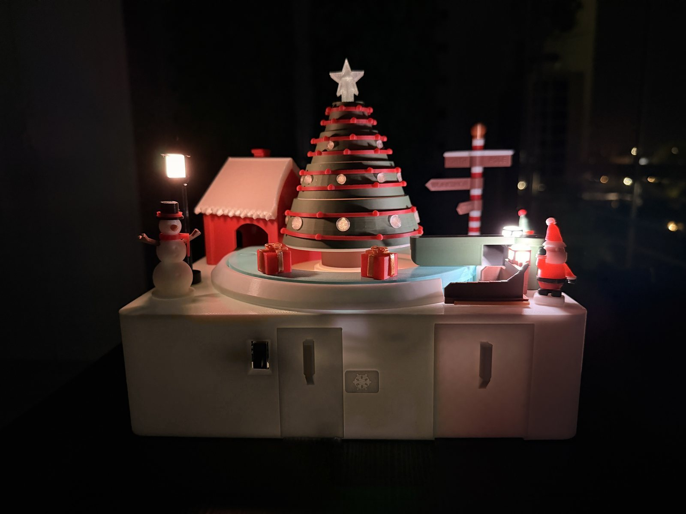
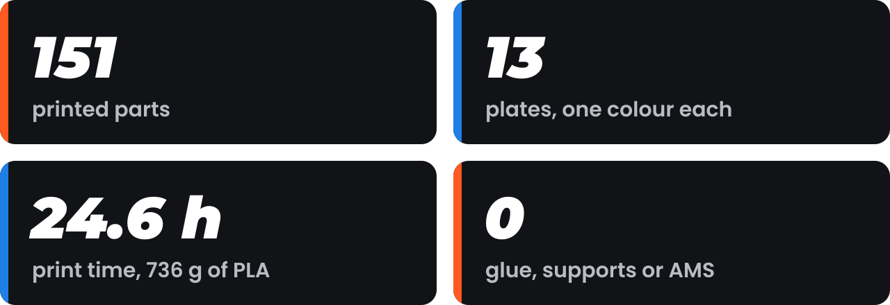
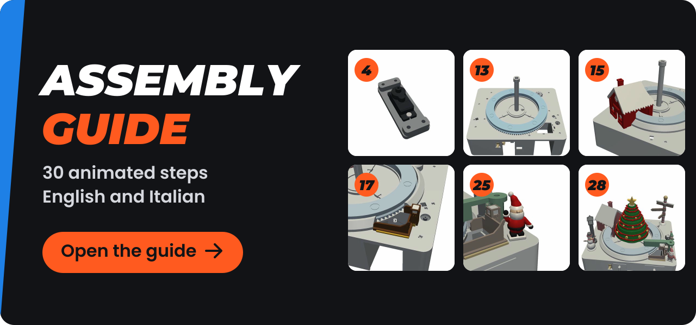
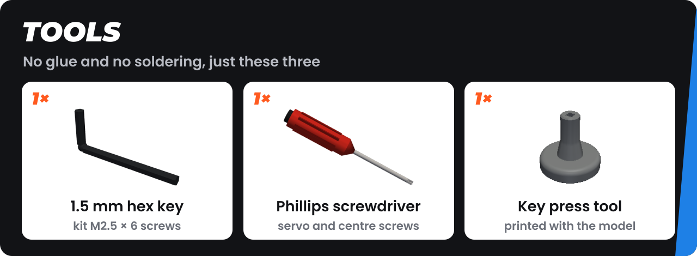
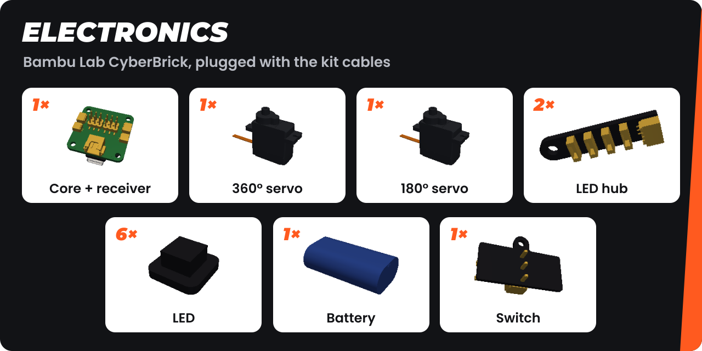
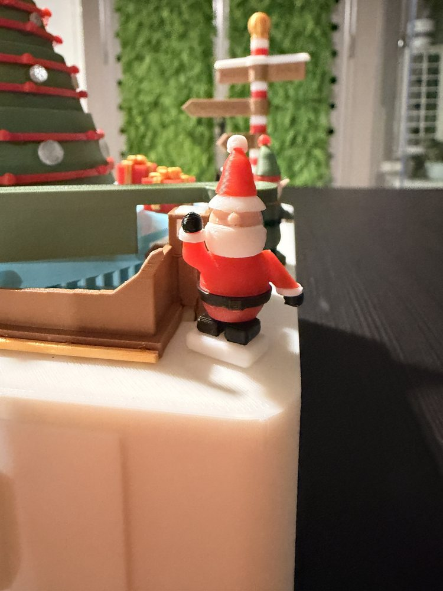
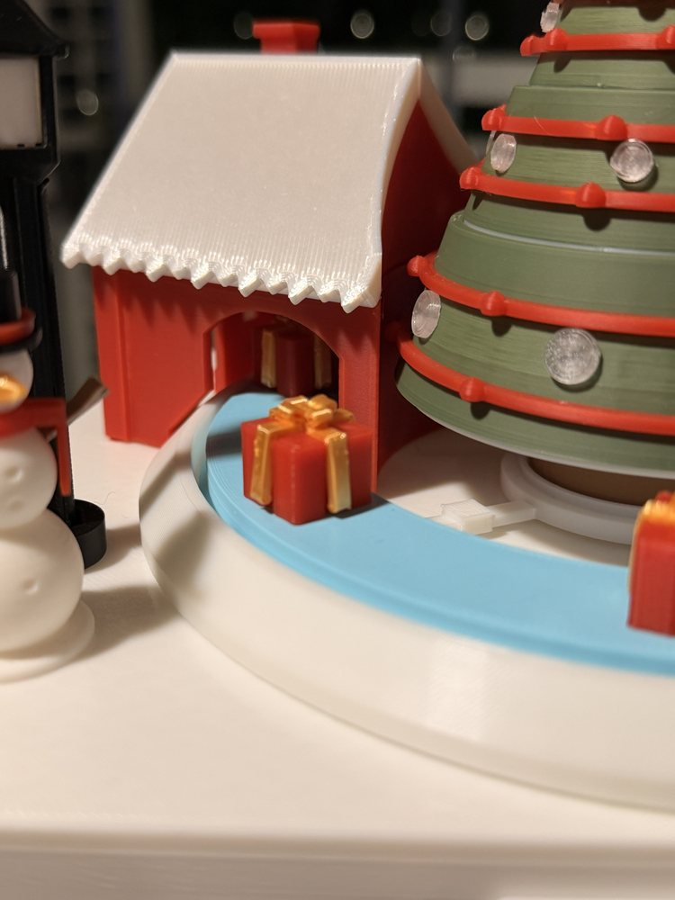

  

  
  
  
  
  

<b>English</b> · <a href="README.it.md">Italiano</a>

  <b>Switch it on and the workshop comes alive.</b> 
  The tree lights up, the gift ring turns, and the elf pushes the gifts one by one through Santa's sleigh into a drawer. No remote, no buttons.

  <a href="#-assembly-guide">Assembly guide</a> ·
  <a href="#-how-it-works">How it works</a> ·
  <a href="#-electronics">Electronics</a> ·
  <a href="#-firmware">Firmware</a> ·
  <a href="ROADMAP.md">Roadmap</a> ·
  <a href="CHANGELOG.md">Changelog</a>

  

  

## 🛠 Assembly guide

  

  
  
  

Thirty-one steps, from snapping the keys off the kit cards to loading the first gifts. Every step has its own animation, the list of parts with the plate they come from, and the actions to tick off. The interactive guide is a single page with an English / Italian switch: download [`docs/index.html`](docs/index.html) together with the `docs/img` folder and open it in a browser.

  

| Phase | Steps | What happens |
| :--- | :---: | :--- |
| **Preparation** | 1–3 | Keys and the press tool, magnets in the gift ring and in the gifts. |
| **Under the base** | 4–10 | Servos, switch, LED hubs and receiver, then the program and a first test. |
| **Scene on top** | 11–20 | Pinion, tree base, gift ring, snow cover, workshop, lamp post, sleigh and the elf. |
| **Lights and closing** | 21–25 | LEDs to the hubs, battery and bottom lid, gift drawer, charging door, USB plug. |
| **Figures and tree** | 26–29 | Santa, the snowman, the North Pole sign post and the tree, tier by tier. |
| **Switch on** | 30–31 | Load the gifts, switch on, and fine tune the show. |

<b>Watch all 31 steps in one animation</b> (5 MB)

 

## 🎄 How it works

1. **Lights on.** The tree, the workshop, the street lamp and both lanterns light up from six LEDs.
2. **Load the gifts.** Six gifts snap onto the magnets of the ring while the lanterns blink green.
3. **The elf picks its moment.** It waits a random time, from 8 to 25 seconds, and now and then it fakes: the arm swings into the empty spot and back out, and nothing drops. Then the elf swings its arm across the track for real, a 360° servo turns the 100-tooth ring one spot through a 12-tooth pinion, and the arm pushes the next gift off.
4. **Into the drawer.** The sleigh has no floor, so each gift drops into a drawer in the front of the base. Each time a gift lands, the tree baubles blink and then dim one step. After the sixth gift the lanterns blink red for a minute, then the lights stay on.

Every switch-on gives a different show.

## ⚡ Electronics

  

Everything comes from the Bambu Lab CyberBrick range and is plugged with the kit cables, no soldering. The parts are held by press fits, snap fits and the kit screws: no glue and no supports. The plates are laid out for a 330 × 320 mm bed (Bambu Lab H2C), one colour per plate, so no AMS is needed.

## 💾 Firmware

[`firmware/main.py`](firmware/main.py) is a standalone MicroPython program for the CyberBrick core. It runs the whole show on its own: light scenes, ring stops and the elf's arm at random moments, with every timing in one settings block at the top. Version 2.6 is still to be tested on the assembled diorama. Wiring and loading steps are in [`firmware/README.md`](firmware/README.md).

## 📸 The printed diorama

  
  
  

  
  
  

### From the workbench

  
  
  

Real photos from the first full assembly.

## 📁 In this repository

| Folder | Content |
| :--- | :--- |
| [`docs/`](docs/) | Interactive assembly guide (`index.html`) and its images. |
| [`docs/pdf/`](docs/pdf/) | The same guide as printable PDF, one file per language. |
| [`firmware/`](firmware/) | MicroPython program for the CyberBrick core and how to load it. |
| [`images/`](images/) | Renders, animations, photos of the printed diorama and of the assembly. |
| [`assets/`](assets/) | Banner, logo and the graphics of this page. |

> [!NOTE]
> The printable files (STL, 3MF, STEP) are not in this repository. Santa's Workshop will be a MakerWorld exclusive, so they will be available only there. The link will be added here when the model is online.

## 📜 License

The guide, images, firmware and documentation in this repository are released under [CC BY-NC-SA 4.0](LICENSE): you can share and adapt them for non-commercial use, with credit to emanuele tech. Selling prints, kits or assembled dioramas needs a commercial license, available on MakerWorld.

---

  
  
   
  Design, prints and photos by <a href="https://github.com/emanueletech">emanuele tech</a>. CyberBrick is a product of Bambu Lab; this project is not affiliated with Bambu Lab.

