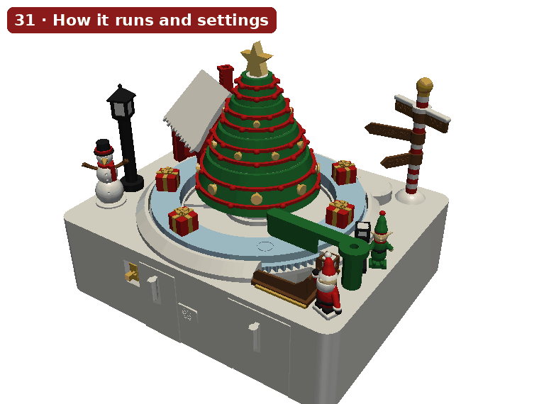
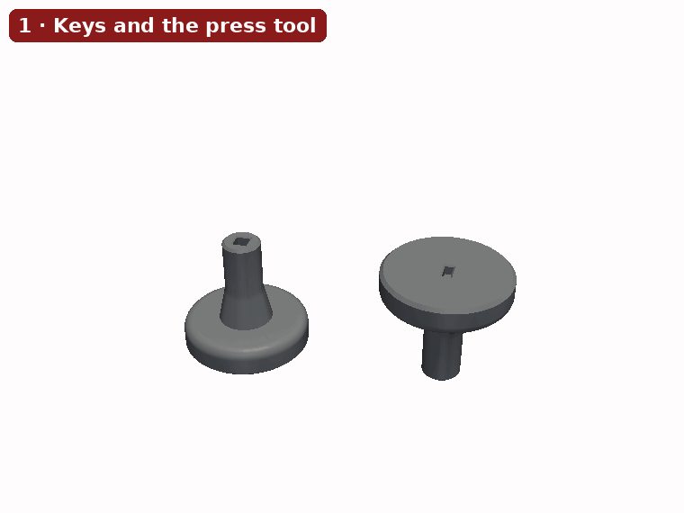

# Santa's Workshop

A 3D printed Christmas diorama that runs by itself. Switch it on and the tree lights up, the gift ring turns, and the elf pushes the gifts one by one through the sleigh into a drawer. It is driven by a Bambu Lab CyberBrick kit, with no remote and no buttons.

> Status: private work in progress. The model is not published yet. The picture above is a CAD render, real photos will replace it.

## What is in this repository

| Folder | Content |
| --- | --- |
| [`docs/`](docs/) | Interactive assembly guide, 30 steps, Italian and English. Open `docs/index.html` in a browser. |
| [`docs/pdf/`](docs/pdf/) | The same guide as printable PDF, one file per language. |
| [`firmware/`](firmware/) | The MicroPython program for the CyberBrick core and how to load it. |
| [`images/`](images/) | Renders, animations and photos taken during the real assembly. |
| [`ROADMAP.md`](ROADMAP.md) | What is still to do before and after publishing. |
| [`CHANGELOG.md`](CHANGELOG.md) | What changed, version by version. |

The printable files (STL, 3MF, STEP) are not here: the model will be a MakerWorld exclusive, so they will be available only on MakerWorld. The link will be added when the model is online.

## The model in numbers

- 150 printed parts on 13 plates, one colour per plate, laid out for a 330 x 320 mm bed (Bambu Lab H2C).
- About 24.5 hours and 730 g of PLA in total, from a real slice.
- No AMS, no glue, no supports. Everything is press fit, snap fit or screwed with the kit screws.
- Electronics: one CyberBrick core with receiver shield, one 360° servo, one 180° servo, two LED hubs, six LEDs, battery and switch. The Beginner kit plus one extra LED hub and one LED 2-pack covers it, or the Ultimate kit alone.

## Assembly

Start from the [interactive guide](docs/index.html) or from the PDF in your language:
[English](docs/pdf/Santas_Workshop_assembly_guide_EN.pdf) · [Italiano](docs/pdf/Santas_Workshop_guida_montaggio_IT.pdf).

## Credits

Design, prints and photos by [emanuele tech](https://github.com/emanueletech). CyberBrick is a product of Bambu Lab; this project is not affiliated with Bambu Lab.
